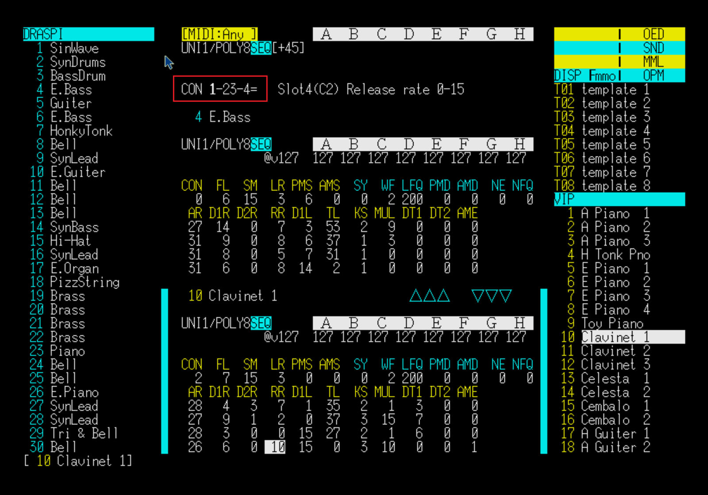

# OED Operator Topology Glyph (OTG)

OTG is a standalone DSL for describing operator topology using compact ASCII glyphs.

**Date Created:** 2026-03-23\
**Last Updated:** 2026-08-03\
**Author:** UG.\
**Covers:** OTG Syntax Specification draft 0.02

---

## Overview

OTG (OED Operator Topology Glyph) is a domain-specific language designed to\
represent operator connection structures (topology) in a concise, human-readable,\
and machine-interpretable form.

It was originally developed for **OPM Tone Editor (a custom FM tone editor\
developed by the author)** and OED (FM tone library format), but is specified here\
as an independent and extensible topology DSL.

---

## What You Can Describe

OTG allows you to describe:

* **Series connections**
* **Parallel mixing** (closed and open)
* **Multiple output chains** (several carriers in one glyph)
* **Feedback loops**
* **Nested structures**
* **Explicit feedback targets**

---

## Quick Examples

### Series

```
1234=
```

```
1 → 2 → 3 → 4 → output
```

---

### Parallel

```
1-2-3-4=
```

```
mix(1,2,3) → 4 → output
```

---

### Parallel with multi-operator branches

```
1-23-4=
```

```
1 → 4
2 → 3 → 4
4 → output
```

Concatenation binds tighter than `-`, so `23` is one branch.

---

### Multiple output chains

```
12=34=
```

```
1 → 2 → output
3 → 4 → output
```

`=` closes a chain; what follows it starts a new one.

---

### Feedback

```
@1
```

```
1 → 1
```

(shown as a fragment; a complete glyph needs an output)

---

### Group Feedback

```
@(12)3=
```

```
1 → 2 → 1
2 → 3 → output
```

---

### Feedback Target (`$`)

```
@(1-$2-)3=
```

```
mix(1,2) → 2
mix(1,2) → 3 → output
```

---

## Reading Rules

Two rules cover most of the notation:

1. **Adjacency is series, and it binds tighter than `-`.**\
   In `65-43-2-1=`, the branches are `65`, `43`, `2`, and `1=` — not six\
   separate operators.

2. **`=` closes a chain.**\
   Its outputs go to the device output, and anything after it is a new\
   structure. `@65=@64=321=` is three chains, not one.

Everything else — `( )`, `@`, `$` — modifies what these two rules operate on.

---

## Real Device Example

OTG can represent real FM synthesizer algorithms.

Example (Yamaha DX7):

```
alg1: @6543=21=
```

```
6 → 6
6 → 5 → 4 → 3 → output
2 → 1 → output
```

See full tables, with the resulting structure for every algorithm:

* [DX7 algorithms](examples/dx7.md) — 32 algorithms
* [YM2151 / YM2203 algorithms](examples/ym2151_ym2203.md) — 8 algorithms

---

## Real-World Usage

OTG is already used in OPM Tone Editor:



---

## Design Goals

* **ASCII-only representation**
* **Human-readable**
* **Machine-interpretable (AST / graph)**
* **One symbol, one meaning**
* **Device-independent**
* **Operator-count independent**
* **Extensible (future topology systems)**

---

## Canonical Form

OTG allows multiple equivalent expressions for the same topology.

However, a **canonical form** can be defined per device by:

1. Preserving exact topology
2. Unifying operator ordering (ascending / descending)
3. Minimizing redundant syntax

---

## Why OTG Exists

OTG was originally developed to solve limitations of traditional FM algorithm\
representation:

* Numeric algorithm IDs are opaque
* Topology is not explicitly visible
* Difficult to extend beyond fixed device definitions

OTG replaces numeric identifiers with explicit structural representation.

For design background and philosophy:

→ [Design Rationale](docs/rationale.md)

---

## Specification

Full syntax and semantics:

→ [Specification (draft version 0.02)](spec/otg-spec-v0.02.md)

---

## Examples

* [DX7 algorithms](examples/dx7.md)
* [YM2151 / YM2203 algorithms](examples/ym2151_ym2203.md)

---

## Implementation Notes

OTG is designed to be easily implemented:

* tokenizer: `$`, `[ ]` support required
* parser: recursive descent recommended
* parse order: `expr → segment → parallel → chain → atom → group`
* a chain is read greedily until `=`, `-`, `)`, or end of glyph
* AST: operator / group / chain / parallel / feedback target
* graph: edge-based construction, with edges held in a **set**
* identifiers resolve to a node table, not to occurrences — the same identifier\
  appearing twice is the same operator

The example tables can be used as regression input: parse each entry and compare\
the resulting edge set against the structure column.

---

## Related Documents

* [Specification (draft 0.02)](spec/otg-spec-v0.02.md)
* [DX7 Examples](examples/dx7.md)
* [YM2151 / YM2203 Examples](examples/ym2151_ym2203.md)
* [Design Rationale](docs/rationale.md)

---

## Status

Draft 0.01 is superseded. The notation is unchanged between 0.01 and 0.02 — every\
glyph written against 0.01 remains valid and means the same thing — but the\
written grammar in 0.01 does not correctly describe it. Implementations should be\
based on 0.02.

This specification is subject to future refinement.

---

## License

MIT License
